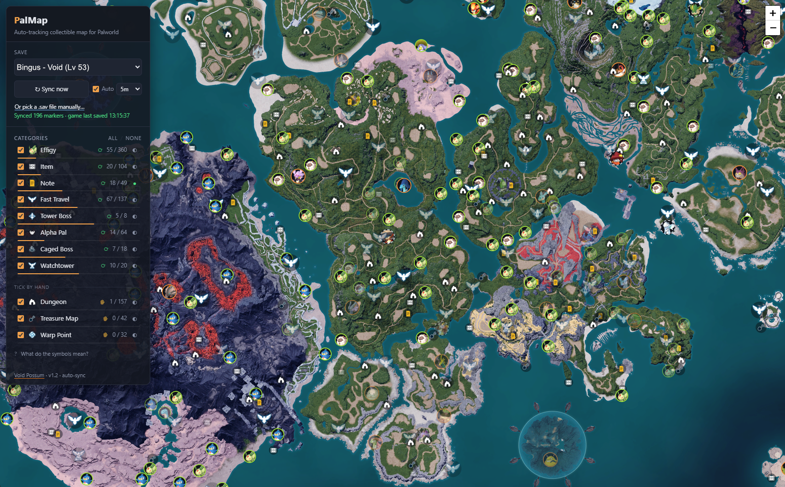

# PalMap

**A Palworld map that ticks itself off.**

PalMap reads your save file and marks everything you've already collected — effigies, bosses,
fast travel points, watchtowers, notes and pickups. Keep it open while you play and it updates
itself.

## Download

### ➡️ [**Download PalMap**](https://github.com/voidpossum/PalMap/archive/refs/heads/main.zip) ⬅️

That link downloads a `.zip`. **Right-click it → Extract All**, and put the folder anywhere you
like (Desktop is fine).

> Don't run it from inside the zip — Windows won't let it work properly. Extract it first.

## Start it

**1. Install Node.js** — only if you don't already have it.
Go to [nodejs.org](https://nodejs.org) and click the big green **LTS** button, then install it.

**2. Double-click `Start PalMap.bat`**

A black window opens and your browser opens the map with your progress already filled in.

Leave the black window open while you play. Close it when you're done.

> Windows may warn about an unrecognised app. Click **More info → Run anyway** — that warning
> appears for any program without a paid certificate.

> On Mac or Linux there's no `.bat`: open a terminal in the folder and run `npm start`.

## Using it

Your save is found automatically — there's nothing to set up.

- **Save** — pick which world, if you have more than one. They're listed by name.
- **Auto** — on by default, re-checks every few minutes while you play.
- **Sync now** — check immediately instead of waiting.
- **Categories** — tick a box to show or hide that kind of marker.
- Click any marker on the map to tick it off by hand.

Next to each category is one of two symbols:

| | |
|---|---|
| ⟳ | **Fills in automatically** from your save. |
| ✋ | **You tick these yourself** — Palworld doesn't record them, so nothing can detect them. |

The **●** button decides what happens to things you've already found: **●** keep showing them,
**◐** fade them, **○** hide them. Shift-click to change every category at once.

## Common questions

**Is this safe? Will I get banned?**
No. PalMap only *reads* your Palworld save — it never changes it, never touches the game, and
never sends anything anywhere. Palworld has no anti-cheat. You can leave the game running.

**Do I have to close Palworld?**
No. Play normally and the map keeps up.

**I collected something and it didn't show up.**
Palworld only writes your save to disk every few minutes. The status line tells you when the game
last saved — if that's older than when you picked the thing up, it'll appear on the next sync.

**Where is my progress kept?**
Things marked ⟳ come from your save, so they're never lost. Things you tick by hand are stored in
a `progress.json` file inside the PalMap folder — keep that file and you keep your progress.

**It can't find my save.**
Click *"Or pick a .sav file manually…"* and choose a file from
`AppData\Local\Pal\Saved\SaveGames\<numbers>\<numbers>\Players\`

**Can my friend use it?**
Yes — send them the download link above, or just copy the whole folder to them.

## What it tracks

Around 760 collectibles that you can actually *finish*:

Effigies · Alpha Pals · Caged Bosses · Tower Bosses · Fast Travel · Watchtowers · Notes ·
Items · Dungeons · Treasure Maps · Warp Points · Skill Fruit Trees

It leaves out chests, eggs, ore and fishing spots on purpose. Those respawn forever, so they can
never be completed — and there are thousands of them, which would bury the island in icons.

## What's in this folder

| | |
|---|---|
| **Start PalMap.bat** | The thing you double-click. |
| `app` | The map itself. |
| `docs` | Screenshot and notes for the curious. |
| `tools` | Scripts for rebuilding map data from game files. You'll never need these. |
| everything else | Plumbing. Leave it alone. |

## Credits

Made by **[Void Possum](https://voidpossum.carrd.co/)**. Free and open source
([GPL-3.0](https://www.gnu.org/licenses/gpl-3.0)).

Map and icons belong to **Pocketpair, Inc.**, used here for a free fan tool.
Save decompression by [ooz-wasm](https://github.com/SnosMe/ooz-wasm); map by
[Leaflet](https://leafletjs.com).

Curious how it works? See **[docs/TECHNICAL.md](docs/TECHNICAL.md)**.
